<!-- ============================================ -->
<!--                  HEADER                      -->
<!-- ============================================ -->

<!-- Intro Header -->

  

<!-- Terminal Introduction -->

  

 

<!-- Coding Animation -->

  

 

<!-- Hacker Terminal Animation -->

  

---

## 🌐 Socials

  
  
  

---

<!-- ============================================ -->
<!--          ANIMATED AI NEURAL NETWORK          -->
<!-- ============================================ -->

## 🤖 AI Neural Network

  

   

  

   

  

---

<!-- ============================================ -->
<!--                  TECH STACK                  -->
<!-- ============================================ -->

## 💻 Tech Stack

### 

### 

### 

### 

### 

### 

---

<!-- ============================================ -->
<!--               DEVELOPER STATUS               -->
<!-- ============================================ -->

## ⚡ Developer Status

---

<!-- ============================================ -->
<!--                GITHUB STATS                  -->
<!-- ============================================ -->

## 📊 GitHub Stats

---

<!-- ============================================ -->
<!--              CONTRIBUTION SNAKE              -->
<!-- ============================================ -->

## 🐍 Contribution Snake

<picture>
  <source media="(prefers-color-scheme: dark)" srcset="https://raw.githubusercontent.com/mithun50/mithun50/output/github-snake-dark.svg"/>
  <source media="(prefers-color-scheme: light)" srcset="https://raw.githubusercontent.com/mithun50/mithun50/output/github-snake.svg"/>
  
</picture>

---

<!-- ============================================ -->
<!--                    FOOTER                    -->
<!-- ============================================ -->

## 💚 Thanks for Visiting

